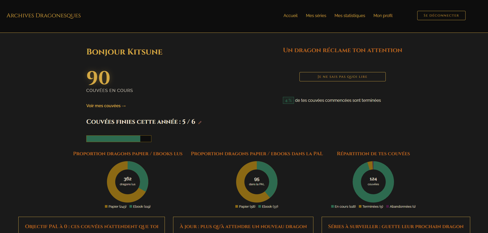
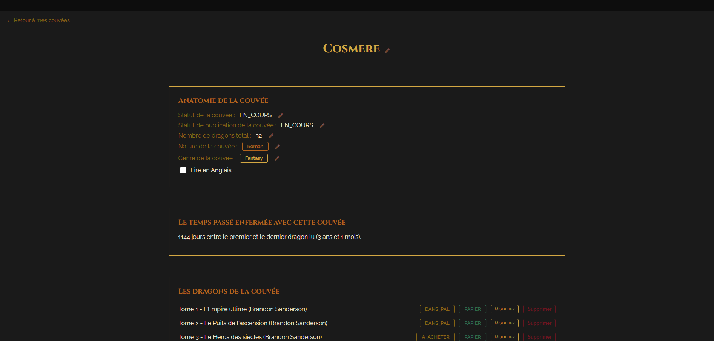
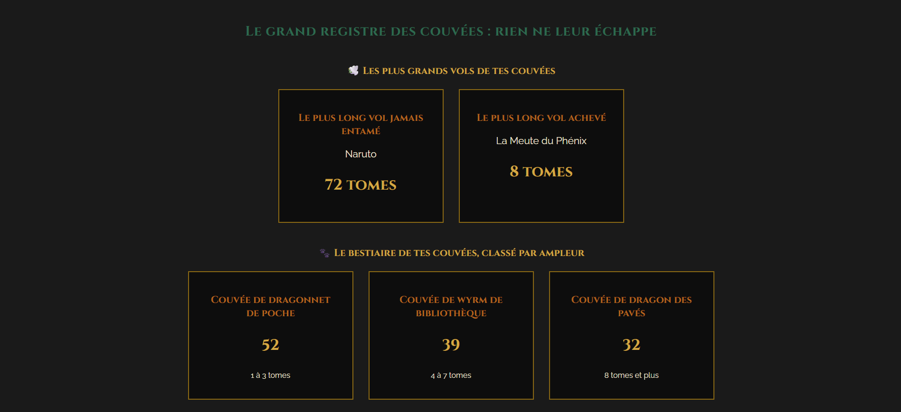
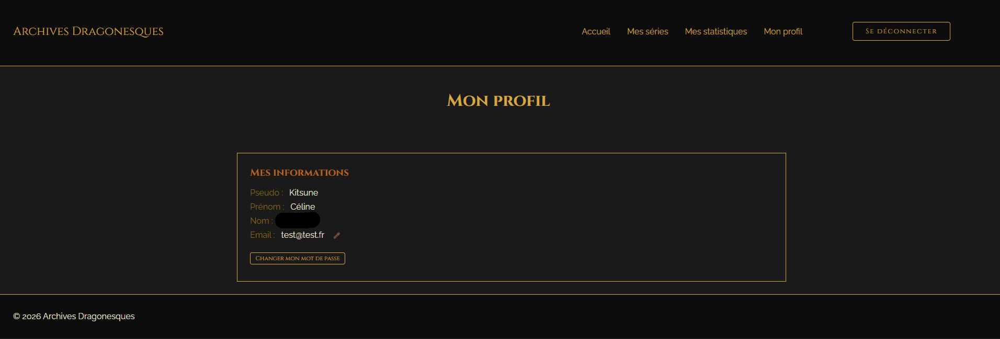

# Les Archives Dragonesques — SuiviDeSeries

Application fullstack de suivi de séries de livres : où j'en suis dans chaque série, ce qu'il me reste à lire, ce que je dois acheter, et des statistiques sur mes lectures.

Projet personnel réalisé après ma certification Concepteur Développeur d'Applications (RNCP niveau 6). Ce dépôt contient le **backend** ; le frontend est ici : [SuiviDeSeriesFront](https://github.com/CelineWau/SuiviDeSeriesFront).







## Fonctionnalités

- **Gestion des séries et des livres** : statut de lecture et de publication, format (papier / ebook), genre, nature (roman, manga, BD…), lecture en anglais.
- **Tableau de bord** : objectif annuel de séries terminées, répartition papier / ebook, répartition des séries par statut, séries presque finies dans la PAL, séries à jour, séries délaissées, PAL vieillissante, suggestion d'ebook au hasard.
- **Listes de courses** papier et ebook, et séries dont il manque des tomes.
- **Statistiques** : séries les plus longues, durée moyenne de lecture, temps passé sur une série, répartition par genre et par nature.
- **Comptes utilisateurs** : inscription, connexion (avec option « rester connecté »), profil, modification de l'email et du mot de passe.

## Stack technique

| Couche | Technologies |
|---|---|
| Backend | Java 21, Spring Boot 4, Spring Data JPA / Hibernate, Spring Security |
| Base de données | MariaDB (H2 en mémoire pour les tests) |
| Authentification | JWT (jjwt), mots de passe chiffrés avec BCrypt |
| Validation | Jakarta Bean Validation |
| Tests | JUnit 5, Mockito, AssertJ, `@DataJpaTest` |
| Frontend | Angular 21 (composants standalone), TypeScript |

## Choix de conception

- **Architecture en couches** : contrôleurs fins, logique métier dans les services, accès aux données dans les repositories (requêtes JPQL personnalisées pour les statistiques).
- **Isolation des données par utilisateur** : chaque requête est filtrée par l'utilisateur connecté (`@AuthenticationPrincipal`). L'accès à une série ou à un livre d'un autre utilisateur renvoie « non trouvé » plutôt que « accès refusé », pour ne pas révéler l'existence des données.
- **Sécurité** : JWT signé avec une durée de vie de 24 h (30 jours avec « rester connecté »), mots de passe chiffrés avec BCrypt, secrets hors du dépôt, CORS centralisé, validation des entrées avec messages d'erreur homogènes.
- **Gestion des erreurs** : un gestionnaire global transforme les erreurs métier et les erreurs de validation en réponses JSON `{ "message": "..." }`.
- **Tests** : plus de 170 tests. Les repositories sont testés avec des données de plusieurs utilisateurs pour prouver le filtrage ; les services sont testés avec Mockito.

## Lancer le projet

### Prérequis

Java 21, MariaDB, Node.js (pour le frontend).

### Backend

1. Créer une base de données MariaDB nommée `suivi_de_series`.
2. Copier `src/main/resources/application.properties.example` vers `src/main/resources/application.properties` (fichier ignoré par git) et renseigner :
    - l'utilisateur et le mot de passe de la base ;
    - `jwt.secret` : une clé encodée en Base64, par exemple générée avec `openssl rand -base64 32`.
3. Lancer l'application :

```bash
./gradlew bootRun
```

L'API écoute sur `http://localhost:8080`.

### Tests

```bash
./gradlew test
```

### Frontend

Voir le dépôt [SuiviDeSeriesFront](https://github.com/CelineWau/SuiviDeSeriesFront) (`npm install` puis `ng serve`, sur `http://localhost:4200`).

## Principaux endpoints

| Méthode | Route | Rôle |
|---|---|---|
| POST | `/auth/register`, `/auth/login` | Inscription, connexion (publics) |
| GET / PATCH | `/profil`, `/profil/email`, `/profil/mot-de-passe` | Profil de l'utilisateur connecté |
| GET / PATCH / DELETE | `/series/...` | Séries et statistiques |
| GET / PATCH / DELETE | `/livres/...` | Livres |
| GET / POST | `/genres` | Genres |
| GET / POST | `/objectifAnnuel` | Objectif annuel de lecture |

Toutes les routes, sauf `/auth/**`, exigent un token JWT (`Authorization: Bearer ...`).

## Pistes d'évolution

- Mot de passe oublié (envoi d'email et jeton temporaire).
- Limitation des tentatives de connexion.
- Mode de vocabulaire « normal » en plus du mode « dragon ».
- Déploiement en ligne avec une démo.
